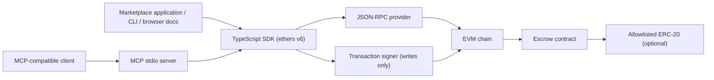

# Architecture

Universal Escrow Protocol is an EVM escrow contract with a reusable ethers v6
SDK. The browser reference targets the user-provided Sepolia deployments; the
CLI, tests, and MCP examples retain separate Hardhat Local configuration. The
integrations call the same SDK and do not simulate chain state.

## Components and request flow

- **Escrow contract:** stores deal terms and lifecycle state, enforces buyer,
  seller, approver, and arbitrator permissions, and holds ETH or supported
  ERC-20 funds until settlement.
- **SDK:** validates chain/address/token configuration, converts human-readable
  amounts, performs ERC-20 allowance setup, sends contract transactions,
  confirms receipts, decodes escrow events, and exposes typed state/errors.
- **MCP server:** publishes eight validated tools and delegates protocol work
  to the SDK. Read tools use a provider; write tools require explicit server
  enablement and a signer.
- **Reference integrations:** `apps/freelance/demo.ts` and
  `apps/p2p/demo.ts` are executable CLI examples using the SDK against
  ephemeral local Hardhat deployments. `web/` provides two separate browser
  reference experiences backed by the same SDK. Browser reads use the
  configured Sepolia JSON-RPC endpoint and do not require a connected wallet.
  Write transactions require a connected injected wallet on Sepolia and
  explicit wallet signing; project/deal notes and
  browser-observed activity are local UI metadata, not contract state.
- **Deployment script:** deploys Escrow and MockERC20 to a running local node,
  allowlists that mock token, and records actual deployment addresses and ABI
  in ignored `deployments/local.json`.

  The browser app uses `BrowserProvider` and the connected wallet's signer for
  writes. `VITE_ESCROW_RPC_URL`, `VITE_ESCROW_CONTRACT_ADDRESS`, and
  `VITE_MUSDC_ADDRESS` configure the public Sepolia reference. Vite values are
  exposed in the bundle; never put a private key or secret RPC credential in a
  `VITE_` variable. The runtime checks Sepolia's chain ID and escrow bytecode
  before enabling interactions, and checks the mUSDC token's six decimals
  before offering it. Writes are signed by the user's connected wallet.

## Lifecycle and supported assets

The buyer creates and funds; the seller submits delivery or the next milestone.
An agreement deadline, when nonzero, is the last permitted funding time and
enables an expiry refund if delivery has not been submitted; zero means no
deadline-based expiry refund.
For a standard two-party escrow, buyer and seller approvals release funds.
Multi-party escrows include the buyer and seller in a unique approver set and
use an explicit threshold; their timeout release is disabled. The immutable
deployer arbitrator can allowlist ERC-20 contracts and settle disputes.

ETH and allowlisted ERC-20 tokens are supported. Fee-on-transfer tokens are
rejected by exact balance-delta checks. NFT and other non-fungible/digital
assets are not implemented. Hardhat chain ID `31337` remains the local test
network. The browser uses the user-provided Sepolia addresses; they have not
been independently verified in this workspace. mUSDC is a mock token with six
decimals, not real USDC.
